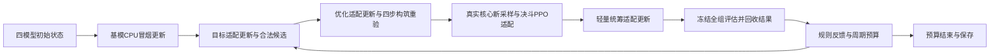

# 四模型交替CPU运行器

本入口复用[本地CPU控制](local-training-control.md)的进程身份、SQLite状态、版本校验、内核期限和用量outbox，增加逐阶段四模型/LoRA检查点。当前是条件通常召唤/弱构筑代理/合成统筹监督的工程课程，不能代表一般构筑或竞技能力；正式ready保持false。[本批验收与剩余缺口](../reports/2026-10-23-four-model-runner.md)记录实证。

## 宿主启用与周期

    .venv/bin/python -m ygo_kito agent-serve \
      --root .cache --state-root .cache/group-training \
      --role trainer --local-cpu-control \
      --local-training-config configs/group-runner-v1.json

默认训练后端关闭。工具请求仍只有training.prepare的run_id、training.control的操作/revision、training.recover等固定契约；opponent没有这些权限，monitor只读。新配方不能通过工具参数传入shell、GPU、任意路径或付费资源。

初始step0保存四个独立模型及空优化器，adapters=null，明确尚未训练。bootstrap在受控worker内执行：两个构筑基模各一次更新、真实核心一局决斗更新、合成规则/概率锚点一次统筹更新；随后冻结全部基模，建立四个独立LoRA会话。后续每周期：

1. build_goal：实际目标适配更新，模型排序合法候选，核心验证起手条件下目标。
2. build_optimizer：实际优化适配更新，执行原定目标→优化→目标→优化四步、逐步核心重验，保留硬目标和主/额外/副卡结构。当前仅通常召唤、额外为空；优化标签仍为印刷攻击力弱代理。
3. duel_train：用本周期构筑、当前适配策略和新种子完成一局真实对局，执行一次实际PPO适配更新。不复用旧周期、历史/外部LLM或验证轨迹。
4. coordinator_train：轻量统筹实际适配更新；当前仍用明示合成规则/概率锚点，未把上一局胜负包装成校准胜率或调度质量标签。
5. evaluate：冻结四模型、基模/适配器、优化器、RNG和训练游标；先注册版本预测/分配真实任务，再用不同对手驱动、牌表变体和验证种子执行完整对局，回收真实结果。训练状态指纹前后一致。
6. feedback：规则统筹终止当前评估片段的任务预算，记录建议/分歧、结果与重构队列；有课程周期预算才进入下一目标阶段，并带入此前反馈和合法incumbent。LLM/学习建议不能改写规则。

候选牌表相同时复用身份，不重命名清空历史；不同构筑保留父谱系。预测绑定实际actor/LoRA/卡组/对手/先后手/版本，百场/千场已有规则保持。强制重构不会因周期结束清除；同牌表不能绕过job.schedule的重构阻断。固定一局工程验证不代替统计校准。

## 配置与计数

| 字段/指标 | 含义 |
| --- | --- |
| workflow | four-model-alternating-v1，沿用其他配置时不会自动切换 |
| max_updates | 此workflow中指课程周期数；默认2，支持有限配置，不是实际优化器次数 |
| stages_per_worker | 一个worker最多提交的阶段数；默认13＝bootstrap＋2×6，达到后paused，显式resume且总预算不重置 |
| validate_every | 当前要求1，即每周期冻结验证，不允许静默跳过 |
| checkpoint_every | 周期定期保留标记；每个完整阶段仍必须保存恢复检查点 |
| wall_seconds | 初始化＋各worker活动段累计上限；默认180秒，不是Codex额度，也不是云实例停止计费条件 |
| bootstrap_seed / train / validation | 基模冒烟、适配采样、验证种子互斥；验证保留不同真实驱动/牌表变体 |
| task / adapters | 宿主指定仓库configs内JSON；任务、数据和适配配置摘要冻结，四角色模板按周期数派生各自最大更新数 |
| coordinator_supervision（可选） | 宿主指定 `configs/...json` 聚合监督；内容摘要绑定恢复，bootstrap 与后续统筹 LoRA 使用同一份标签 |
| metrics.steps / committed_stages | 阶段提交数量；两周期完成为13，不冒充13次参数更新 |
| metrics.optimizer_updates | 实际已提交参数更新；默认基模4＋适配8＝12 |
| episodes / validation_episodes | 默认每运行3场已提交训练（含bootstrap）和2场已提交冻结验证 |

默认种子bootstrap1724、适配1725/1726、验证1001724。train/validation按完整本席位轨迹分别落盘，种子/审计不进入DTO；隐藏身份/攻防为空或省略。固定验证种子跨周期复用，不称独立终验集。构筑训练数据仍是工程样例，不是用户未来3＋8套牌表。

不提供 `coordinator_supervision` 时仍使用 `synthetic_rule_imitation_and_probability_anchors`，包括显式时期配方；时期数据不会自动变成统筹监督。显式文件可采用 `host_logged_supervision_v1`：顶层为 `source/records/real_win_rate_supervision:false/sha256`（`sha256` 是 records 的规范 JSON 摘要），每行包含现有公开聚合 `context`、`route_label`、可空 `forecast_target` 和 `provenance`（`dataset_id/record_id/source/evidence_sha256`）。缺失 forecast 标签只训练路由，不补造概率锚点，也不更新 forecast_head 的适配参数。默认统筹适配目标仍为 encoder 和 route_head；需要直接适配 forecast_head 时由宿主明确列入 adapters 配置。

更新记录明确监督来源、摘要、forecast 标注行数，保留 `supervision_evidence_verified:false / real_win_rate_supervision:false / calibration:pending`。程序校验结构与摘要，不能凭来源字符串或哈希证明标签真实、胜率校准或调度质量；小合成日志的 CPU 损失/恢复测试只证明工程接线。文件内容改变后原恢复绑定拒绝，不能绕过旧源码/资源门禁。

## 检查点、恢复和预算

每个完成阶段产生完整weights、字节/SHA sidecar和stages/step-N.json；最后SQL事务才提交阶段/模型版本/数据标记。检查点含四基模与各自优化器/调度器、四适配器权重/优化器/调度器/RNG/基模绑定、下一阶段/周期、已消费阶段ID、已提交数据分片标记、Torch/Python/采样及批次RNG、版本、统筹台账和累计预算快照。后者含计划摘要、已结算/当时观察active、已测CPU/未知段和outbox前缀；恢复要求当前SQL至少保留这些已花用量，不能用较早模型检查点回退实际成本。step0尚未完成初始化记账会明确标记，不冒充已核账零成本。支持目标已更新但优化/统筹尚未更新的合法边界，不要求四角色同时到同一更新数。

恢复只加载完整已提交阶段；完整文件/清单全部校验后才可采纳未登记下一阶段，部分发布隔离，数据/内部阶段/版本不符则拒绝。评估中的working台账可包含未完成领取，恢复使用检查点内的完整台账，保留工作副本供审计；不把遗留leased任务当已完成。恢复后从下一阶段执行，已提交参数更新不重做。只有未提交决斗阶段才重新从当前策略/保存的RNG采样，持久旧分片不供PPO继续消费。

pause/stop保存到完整阶段后退出worker；无响应的强制pause需显式recover。阶段片段预算达到后paused，可在同一总active预算内显式resume。总active预算不足以完成下一阶段则stopped并保存有效状态，拒绝自动续额；状态仍可加载核验，不声称越过总预算继续训练。用量outbox按实际代次记录，同代次确认丢失先回读，重做耗时另计，失联CPU未知/墙钟上界保留。

单个worker的内核期限仅保护该本地进程，**不控制腾讯云CVM或计费**。100h规划不变，没有100h实跑/GPU吞吐/计费停机证据。正式云资源租约、CodeBuddy/DeepSeek实际权限/额度与PC兼容仍须目标环境验证。

## 短验收与后续

    .venv/bin/python -m ygo_kito group-runner-acceptance \
      --root .cache --state-root .cache/group-runner-delivery \
      --run-id UNIQUE-GROUP-ID

命令限定两周期、每运行≤180active秒，分别执行真实中断恢复、连续对照和阶段预算暂停/恢复。会故意终止自建评估worker一次；已有ID拒绝覆盖。输出experiments/ID/proof.json，完整对局、参数更新和恢复比较是真实执行；文件发布/内部游标损坏负例另在集成测试标为故障夹具。

本默认课程仍是条件通常召唤/弱代理，不能称为一般CB、三期课程/大数据加载或合格对手资格。后续新增的[额外/素材与真实成对实战数据路径](extra-material-feedback.md)有独立CPU验收入口，通过同一BuildTrainer支持实际比较监督；没有静默替换本配置课程。因源码/特征版本提升，旧检查点需原源提交重现或另作显式迁移，不能跳过版本检查。当前总缺口以[总清单](../plans/MASTER-CHECKLIST.md)和[最新额外报告](../reports/2026-10-23-extra-material-feedback.md)为准，旧报告保留当时证据。不降低门槛；无付费资源/凭据/重置卡，20%保存停止，学习TODO不改。
